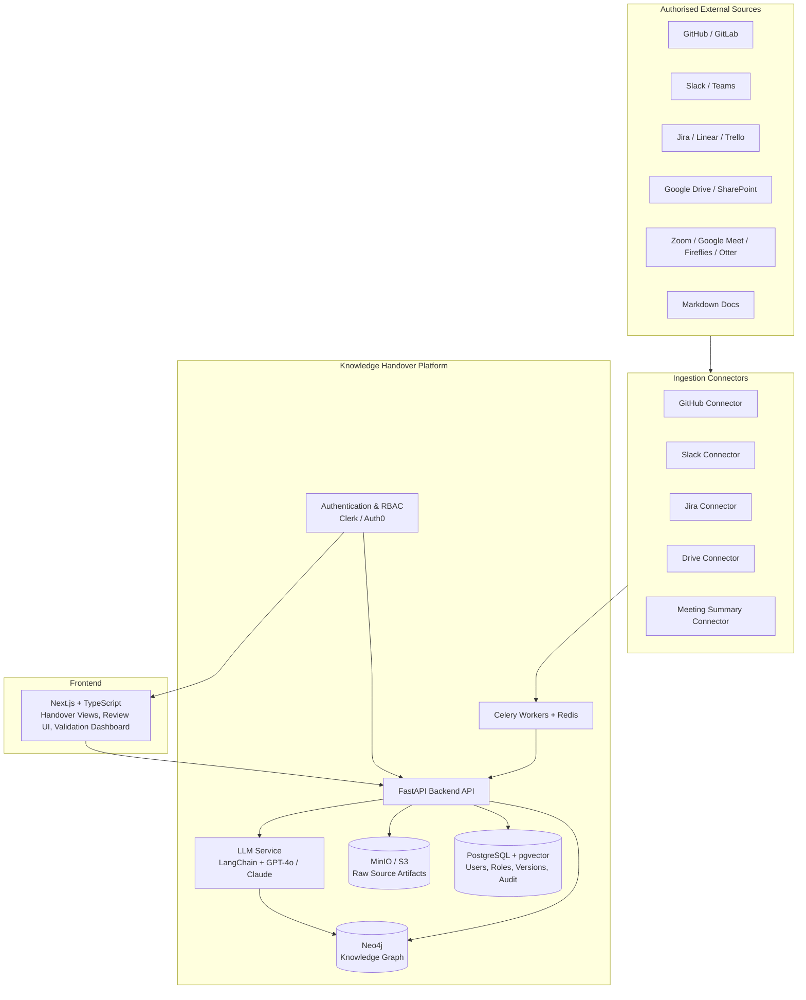
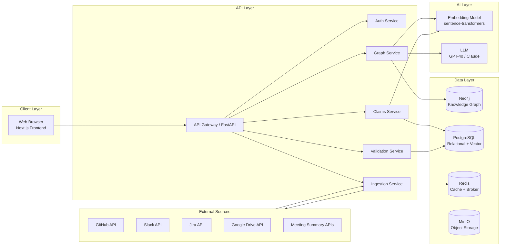
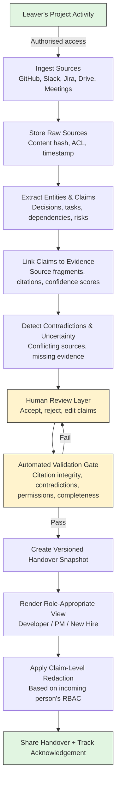
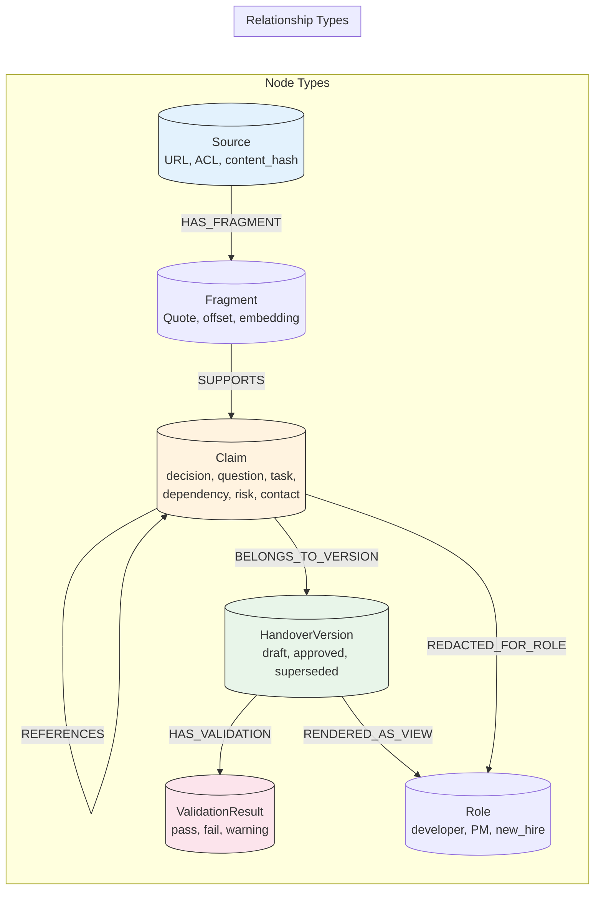
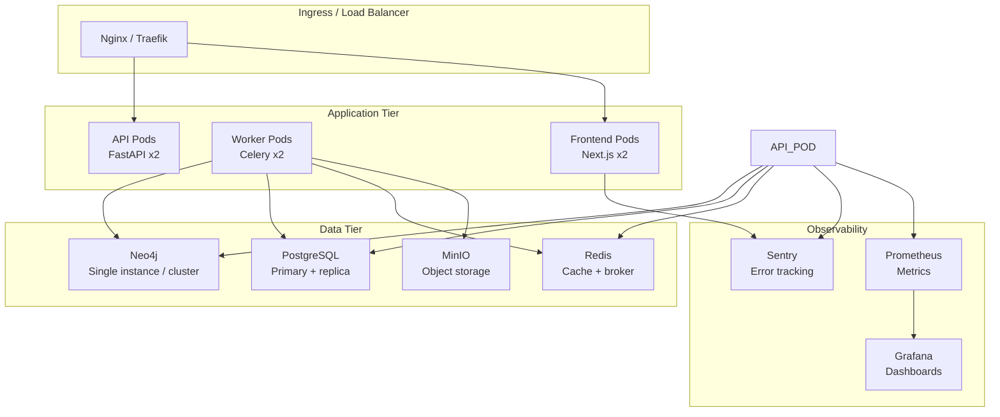
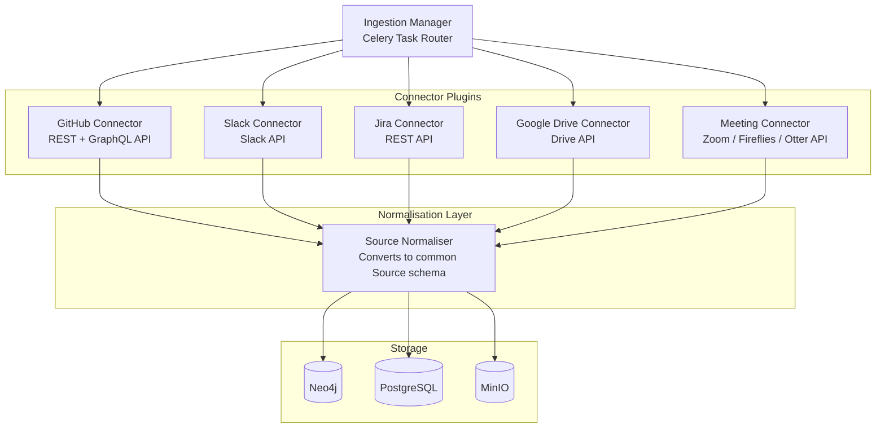

# Knowledge Handover Platform — Architecture Diagrams

## 1. High-Level System Architecture

---

## 2. Component Architecture (C4-Style Container Diagram)

---

## 3. Data Flow Diagram (Connect → Handover)

---

## 4. Knowledge Graph Schema (Neo4j)

---

## 5. Deployment Architecture (Docker Compose / Kubernetes)

---

## 6. Connector Architecture (Pluggable)

---

## Diagram Legend

| Color | Meaning |
|-------|---------|
| 🟢 Green | Start / End points (successful outcomes) |
| 🟡 Yellow | Human-in-the-loop steps (Review, Validation gate) |
| 🔵 Blue | Data sources and storage |
| ⚪ White | Application logic and services |
