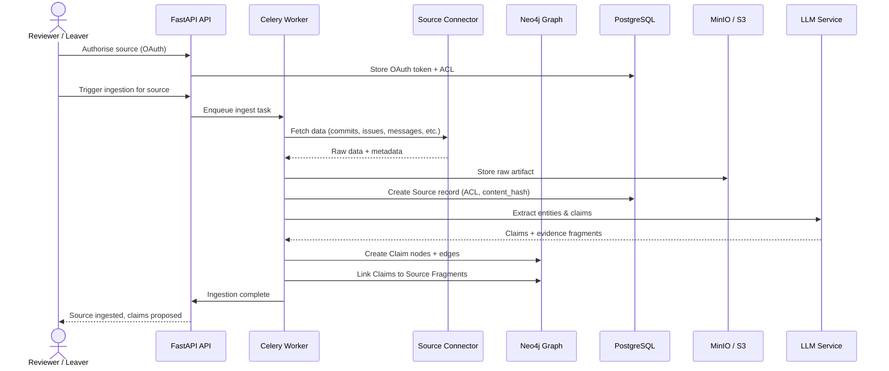
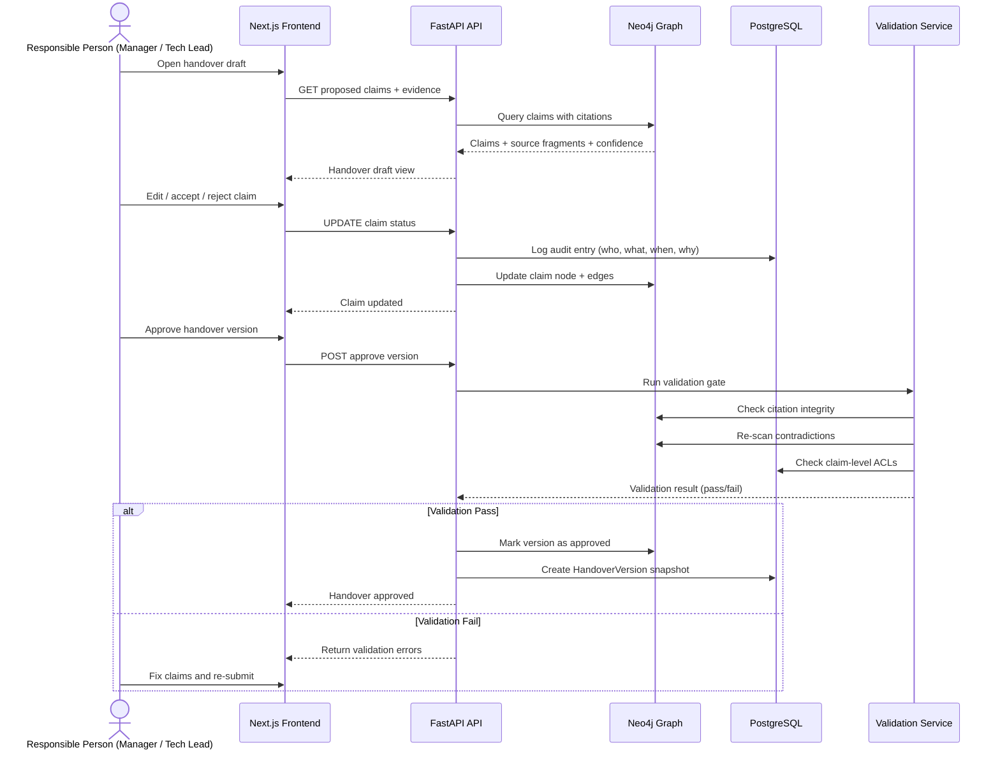
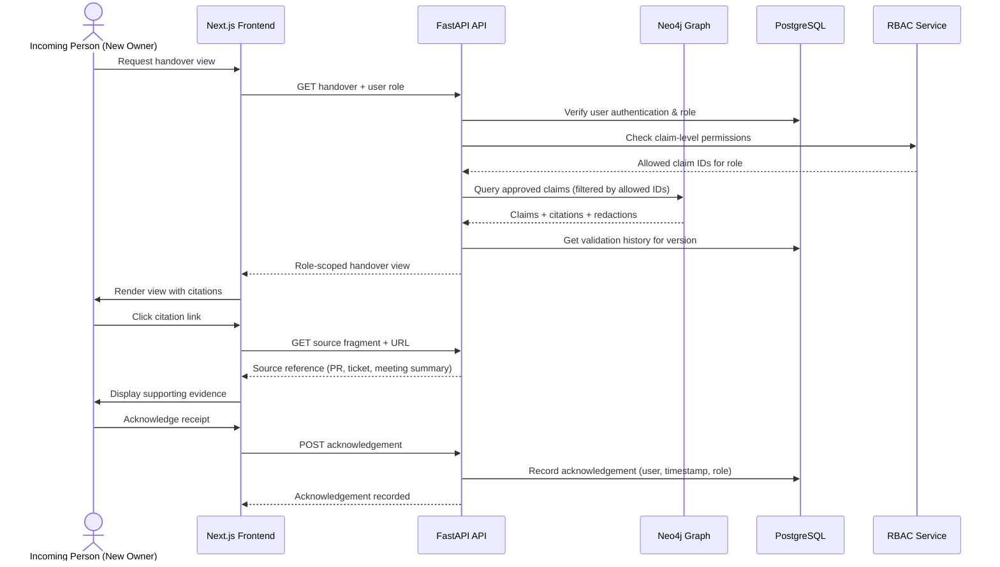
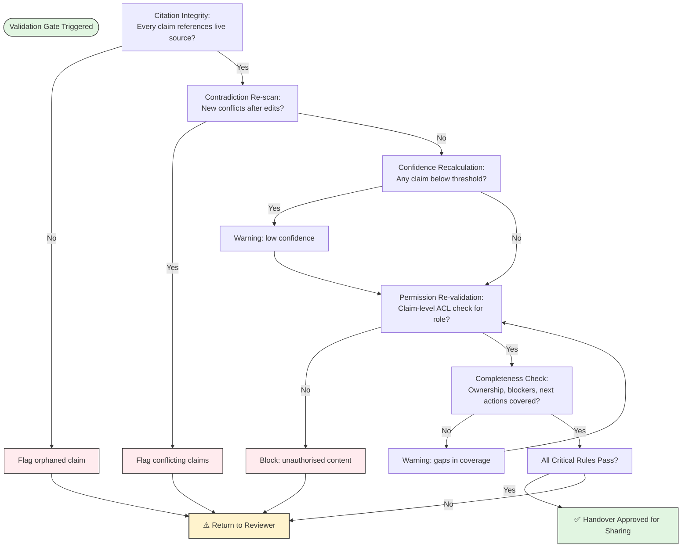
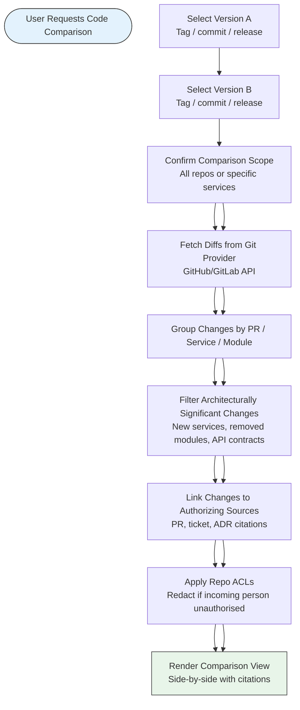

# Knowledge Handover Platform — Workflow Diagrams

## 1. Core Handover Workflow (6 Layers)

```mermaid
flowchart LR
    subgraph Layer1 [Layer 1: Connect]
        L1[Connect<br/>Ingest authorised sources]
    end
    
    subgraph Layer2 [Layer 2: Reconstruct]
        L2[Reconstruct<br/>Build knowledge graph]
    end
    
    subgraph Layer3 [Layer 3: Verify]
        L3[Verify<br/>Link claims to evidence]
    end
    
    subgraph Layer4 [Layer 4: Review]
        L4[Review<br/>Human-in-the-loop]
    end
    
    subgraph Layer5 [Layer 5: Validate]
        L5[Validate<br/>Automated gate]
    end
    
    subgraph Layer6 [Layer 6: Handover]
        L6[Handover<br/>Role-appropriate view]
    end
    
    L1 --> L2 --> L3 --> L4 --> L5 --> L6
    
    style L1 fill:#e3f2fd,stroke:#333
    style L2 fill:#e3f2fd,stroke:#333
    style L3 fill:#e3f2fd,stroke:#333
    style L4 fill:#fff3cd,stroke:#333,stroke-width:2px
    style L5 fill:#fff3cd,stroke:#333,stroke-width:2px
    style L6 fill:#e8f5e9,stroke:#333
```



---

## 2. Detailed Workflow — From Source to Handover

```mermaid
flowchart TD
    Start([Start: Leaver Departure Detected])
    
    subgraph Connect [Connect Layer]
        C1[Select Sources<br/>GitHub, Slack, Jira, Drive, Meetings]
        C2[OAuth / Authorise Access]
        C3[Pull Data via Connectors]
        C4[Store as Source Records<br/>ACL + content hash + timestamp]
    end
    
    subgraph Reconstruct [Reconstruct Layer]
        R1[Entity Extraction<br/>People, services, APIs, tools]
        R2[Decision Detection<br/>ADRs, PR merges, "agreed" patterns]
        R3[Ownership Inference<br/>CODEOWNERS, git blame, assignees]
        R4[Timeline Assembly<br/>Chronological decision graph]
        R5[Dependency Mapping<br/>Imports, service calls, ticket links]
    end
    
    subgraph Verify [Verify Layer]
        V1[Link Claims to Source Fragments]
        V2[Assign Confidence Scores<br/>0.0–1.0]
        V3[Detect Contradictions<br/>Conflicting sources]
        V4[Flag Uncertainty<br/>Missing or low-confidence evidence]
    end
    
    subgraph Review [Review Layer - Human]
        RV1[Reviewer Opens Handover Draft]
        RV2[Accept / Reject / Edit Claims]
        RV3[Merge Duplicate Nodes]
        RV4[Add Manual Notes]
        RV5[Approve Versioned Snapshot]
    end
    
    subgraph Validate [Validate Layer - Automated Gate]
        VA1[Citation Integrity Check]
        VA2[Contradiction Re-scan]
        VA3[Confidence Recalculation]
        VA4[Permission Re-validation<br/>Claim-level ACL check]
        VA5[Completeness Check<br/>Ownership, blockers, next actions]
        VA6[Pass / Fail Gate]
    end
    
    subgraph Handover [Handover Layer]
        H1[Select Incoming Person's Role<br/>Developer / PM / New Hire]
        H2[Render Role-Appropriate View]
        H3[Apply Claim-Level Redaction]
        H4[Share Handover Package]
        H5[Track Acknowledgement of Receipt]
    end
    
    Start --> C1 --> C2 --> C3 --> C4
    C4 --> R1 --> R2 --> R3 --> R4 --> R5
    R5 --> V1 --> V2 --> V3 --> V4
    V4 --> RV1 --> RV2 --> RV3 --> RV4 --> RV5
    RV5 --> VA1 --> VA2 --> VA3 --> VA4 --> VA5 --> VA6
    
    VA6 -->|Fail| RV1
    VA6 -->|Pass| H1 --> H2 --> H3 --> H4 --> H5
    
    style Start fill:#e1f5e1,stroke:#333
    style H5 fill:#e1f5e1,stroke:#333
    style RV5 fill:#fff3cd,stroke:#333,stroke-width:2px
    style VA6 fill:#fff3cd,stroke:#333,stroke-width:2px
```

---

## 3. Sequence Diagram — Ingesting a New Source



---

## 4. Sequence Diagram — Review & Validate Handover



---

## 5. Sequence Diagram — Role-Appropriate Handover Rendering



---

## 6. Validation Gate Decision Flow



---

## 7. Phase 3 — On-Demand Code Version Comparison Workflow



---

## Diagram Usage

These Mermaid diagrams can be rendered in:
- **GitHub** (native Mermaid support in `.md` files)
- **Notion** (Mermaid blocks)
- **Obsidian** (Mermaid plugin)
- **Mermaid Live Editor** (https://mermaid.live)

Each diagram is self-contained in its code block and can be copied directly into documentation or a wiki.